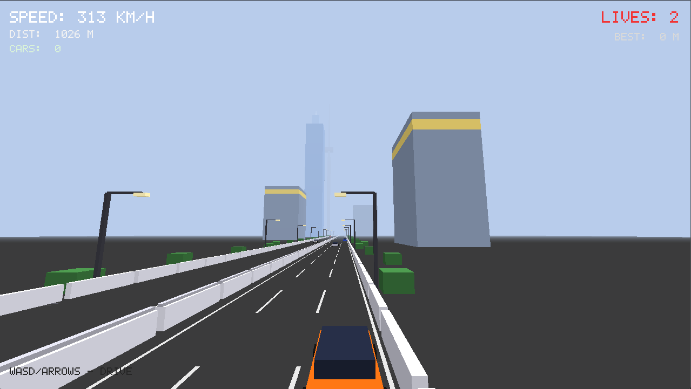

# Moscow Road Racing 

Низкоуровневая 3D-игра в жанре "гонки", написанная на **C++** с использованием кроссплатформенной библиотеки **GLFW** и **OpenGL** без использования сторонних игровых движков



## ✨ Особенности проекта
- **Кроссплатформенная графика:** Прямой рендеринг через OpenGL и управление окнным контекстом через GLFW.
- **Реалистичная физика:** Модель движения автомобиля учитывает тягу двигателя, трение качения и аэродинамическое сопротивление ($F = K \cdot v^2$).
- **Собственный движок шрифтов:** Попиксельный вывод ASCII-символов на экран через битовые маски.
- **Чистый код:** Проект реализован в одном файле `moscow.cpp` (более 600 строк кода) с акцентом на высокую производительность.

## 🛠️ Сборка и запуск в Linux

Для компиляции вам понадобятся библиотеки X11 и OpenGL. На современных дистрибутивах (Arch Linux, Fedora, Ubuntu) сборка максимально упрощена благодаря `Makefile`.

### Сборка:
```bash
make
```

### Запуск:
```bash
./moscow
```

### Очистка бинарников:
```bash
make clean
```

## 📋 Технические требования

Поскольку игра написана на чистом C++ без использования тяжелых сторонних игровых движков, она обладает экстремально высокой производительностью и запустится даже на самом слабом железе. Однако для сборки проекта в системе должны быть установлены необходимые графические библиотеки и инструменты компиляции.

### 🐧 Поддерживаемые ОС:
* **Windows** (С недавнего момента перенос версии игры на **GLFW** позволяет запускать игру)
* **Linux** (Разработка и тестирование велись на **Arch Linux** и **Fedora Linux**).

### 🛠 Зависимости для компиляции:
Для успешной сборки через `make` вам понадобятся следующие пакеты:
* **Компилятор:** `g++` (с поддержкой стандарта C++11 или выше).
* **Система сборки:** `make`.
* **Графические библиотеки:**
  * **GLFW3** (Для создания кроссплатформенных окон и обработки ввода).
  * **OpenGL** (GL, GLU) для аппаратного 3D-рендеринга.

### 📦 Команда для установки зависимостей:

* **На Arch Linux:**
  ```bash
  sudo pacman -S base-devel glfw-wayland mesa glu
  ```
* **На Fedora:**
  ```bash
  sudo dnf groupinstall "Development Tools"
  sudo dnf install glfw-devel mesa-libGL-devel mesa-libGLU-devel

  ```
* **На Ubuntu / Debian:**
  ```bash
  sudo apt update
  sudo apt install build-essential libglfw3-dev libgl1-mesa-dev libglu1-mesa-dev

  ```
### 🪟 Сборка и запуск в Windows

Для сборки проекта на Windows вам понадобится компилятор (MinGW/GCC или MSVC) и скомпилированные бинарники GLFW.

1. **Через MSYS2 (Рекомендуемый способ в стиле Linux):**
   * Установите [MSYS2](https://msys2.org).
   * Откройте терминал Мингв (UCRT64) и установите стек компилятора и GLFW:
     ```bash
     pacman -S mingw-w64-ucrt-x86_64-gcc mingw-w64-ucrt-x86_64-make mingw-w64-ucrt-x86_64-glfw
     ```
   * Скомпилируйте проект:
     ```bash
     g++ moscow.cpp -o moscow.exe -lglfw3 -lopengl32 -lglu32
     ```

2. **Через Visual Studio:**
   * Создайте пустой проект C++.
   * Установите зависимость `glfw` через встроенный менеджер пакетов **Nuget** (Проект -> Управление пакетами NuGet -> Поиск: `glfw`).
   * Добавьте в линковщик (Linker -> Input) системные библиотеки: `opengl32.lib` и `glu32.lib`.


## 📜 Разработчик
- **Логин на GitHub:** [timur-walkuriscky](https://github.com/timur-walkuriscky)
- **Платформа разработки:** Arch Linux

